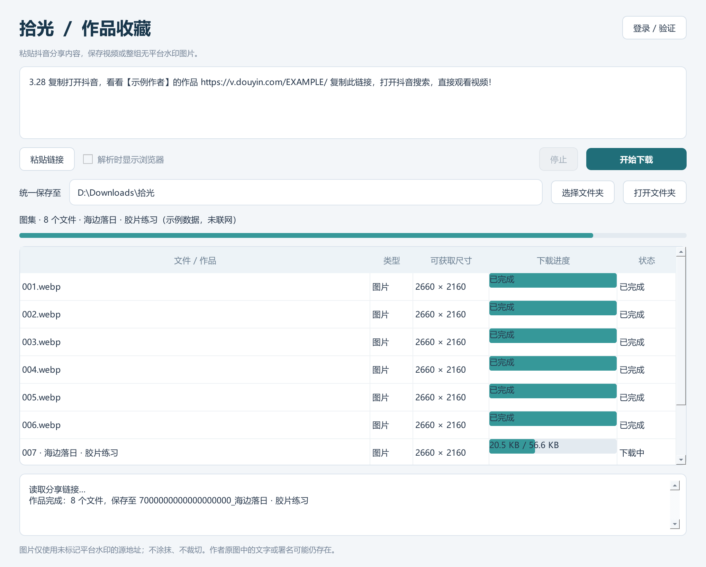

# 拾光 · 抖音视频与图集下载器

一个在本地运行的 Windows 桌面工具：粘贴抖音分享文字，保存单个作品的**视频**或**整组图集**。图集按原顺序完整保存，优先使用页面提供的无平台水印图片源；视频优先选择最高分辨率与码率。不经过第三方代解析网站，不做涂抹、裁切或二次压缩。


[](LICENSE)
[](https://www.python.org/)
[](#系统要求)



> 界面预览使用示例数据，未联网。实际界面文字与布局以当前版本为准。

## 功能

- **视频**：从页面提供的格式中选择分辨率最高、同分辨率下码率更高的版本。
- **图集**：识别完整图片清单，按 `001、002……` 原顺序保存，不把封面、头像或推荐作品混入。
- **真实格式**：根据文件头判断 JPG / PNG / WebP / AVIF / HEIC 等，不使用伪装扩展名。
- **无平台水印优先**：过滤 `tplv-dy-water-v2` 等已知水印模板；只有水印地址时明确报错，不静默降级。
- **批量处理**：一次粘贴多个作品链接，逐个解析与下载。
- **本机登录**：使用独立的 Edge / Chrome 资料目录完成登录或验证，不读取日常浏览器账号。
- **可停止**：停止后等待当前连接返回，清理未完成的 `.part` 文件，已完成文件保留。
- **可核对**：每个作品生成 `作品信息.json`，记录文件大小、尺寸与 SHA-256。
- **不覆盖**：重复下载自动添加序号，已有文件不会被覆盖。

## 系统要求

| 项目 | 要求 |
| --- | --- |
| 操作系统 | Windows 10 / 11（发布包为 Windows x64） |
| Python（源码运行） | 3.11 及以上，推荐 3.13 x64 |
| 浏览器 | 已安装 Microsoft Edge 或 Google Chrome |
| 网络 | 可访问抖音页面与媒体 CDN |

程序不下载额外的浏览器引擎，直接复用本机已安装的 Edge / Chrome。

## 快速开始

### 方式一：使用发布包（推荐）

1. 打开 [Releases](https://github.com/Truessin/shiguang-downloader/releases)，下载最新 Windows 压缩包。
2. **完整解压**后双击 `Shiguang.exe`。请保留同目录的 `_internal` 文件夹，不要只移动 EXE。
3. 在抖音作品中点击“分享 → 复制链接”，把整段分享文字粘贴到输入框。
4. 点击“开始下载”，完成后点击“打开文件夹”。

默认保存到程序目录下的 `downloads`，可在界面中更改统一保存位置。

### 方式二：从源码运行

```powershell
git clone https://github.com/Truessin/shiguang-downloader.git
cd shiguang-downloader
python -m venv .venv
.\.venv\Scripts\python.exe -m pip install -r requirements.txt
.\.venv\Scripts\python.exe app.py
```

## 使用说明

1. **粘贴链接**：支持 `v.douyin.com` 短链、作品完整链接，以及包含链接的整段分享文案；可一次粘贴多个。
2. **开始下载**：程序自动判断视频或图集，并为每个作品建立单独文件夹。
3. **需要登录时**：点击“登录 / 验证”，在专用浏览器窗口中正常完成登录，然后**关闭该窗口**返回程序。必要时勾选“解析时显示浏览器”。
4. **查看结果**：点击“打开文件夹”，或双击列表中已完成的文件。

输出结构示例：

```text
downloads/
└── 7690457558616945051_作品标题/
    ├── 001.webp
    ├── 002.webp
    ├── ...
    └── 作品信息.json
```

`作品信息.json` 包含作品编号、标题、作者、来源链接、每个文件的大小、尺寸与 SHA-256，不包含 Cookie、签名 URL 或登录信息。

更多细节见 [使用说明](docs/USAGE.md) 与 [常见问题](docs/FAQ.md)。

## 工作原理

```text
分享链接 → 解析作品编号 → 读取页面公开数据 / 详情响应 / 专用浏览器
        → 匹配与作品编号一致的媒体清单
        → 过滤已知平台水印地址、选择最佳清晰度
        → 流式下载 → 文件头校验 → 大小校验 → 原子重命名 → 写入清单
```

- 页面数据只做 **JSON 解析**，不执行分享页面中的脚本。
- 所有请求都限制在抖音及其媒体域名内，重定向逐跳校验，拒绝内网与非目标域名。
- 每个媒体地址有多个候选时按顺序尝试；全部失败才标记失败，不会把不完整文件当作成功。

架构与模块说明见 [开发文档](docs/DEVELOPMENT.md)。

## 已知限制

- 仅支持**单个公开作品**的视频或图集；不支持主页批量抓取、直播、私密或付费内容。
- 不绕过登录、验证码或访问限制；遇到验证时需要在专用浏览器中手动完成。
- 平台可能压缩上传内容，无法还原为上传前的原始文件；不同作品提供的清晰度、格式与水印情况不同。
- 作者在源图中自带的文字、署名或水印不会被去除；本工具也不做去水印处理。
- 页面结构变化时解析可能失效，需要更新代码。
- 暂不支持跨次断点续传。

## 项目结构

```text
.
├── app.py                      # PyQt6 界面与后台线程
├── browser.py                  # Playwright + 本机 Edge / Chrome
├── core.py                     # 链接解析、媒体选择、下载与校验
├── version.py                  # 版本号单一来源
├── build.ps1                   # 测试 + 打包 Windows 发布包
├── tests/                      # pytest 测试（核心逻辑与离屏界面）
├── tools/                      # 维护脚本（README 截图生成）
├── docs/                       # 使用、开发、隐私、FAQ、验证记录
├── third_party_licenses/       # 第三方组件许可证原文
├── THIRD_PARTY_NOTICES.md      # 第三方组件与许可说明
├── pyproject.toml              # pytest / ruff 配置
└── requirements*.txt
```

## 开发与测试

```powershell
python -m venv .venv
.\.venv\Scripts\python.exe -m pip install -r requirements-dev.txt

# 运行测试（界面测试使用离屏模式，不弹窗）
$env:QT_QPA_PLATFORM = 'offscreen'
.\.venv\Scripts\python.exe -m pytest

# 代码检查
.\.venv\Scripts\python.exe -m ruff check .

# 构建发布包（需在 Windows 上执行）
.\build.ps1
```

构建产物位于 `dist\Shiguang\`，并生成 `dist\Shiguang-v<版本>-win64.zip`。欢迎提交 Issue 或 Pull Request，请先阅读 [贡献指南](CONTRIBUTING.md)。

## 文档

- [使用说明](docs/USAGE.md)
- [常见问题](docs/FAQ.md)
- [开发与构建](docs/DEVELOPMENT.md)
- [隐私与安全](docs/PRIVACY.md)
- [验证记录](docs/VALIDATION.md)
- [更新日志](CHANGELOG.md)

## 许可证

本项目以 [GNU General Public License v3.0](LICENSE) 发布。第三方依赖及其许可证见 [THIRD_PARTY_NOTICES.md](THIRD_PARTY_NOTICES.md) 与 [`third_party_licenses/`](third_party_licenses/)。

## 免责声明

本项目与抖音 / 字节跳动无任何关联，未获得其授权或认可。

本工具仅用于备份**你本人创作**或**已获得权利人许可**的公开内容。使用者应自行确认下载、保存与再使用行为符合平台服务条款、著作权法及当地法律法规。请勿将本工具用于商业侵权、批量抓取、绕过访问控制或传播他人作品。

软件按“现状”提供，不附带任何明示或暗示担保；作者不对使用本工具造成的任何后果负责。
